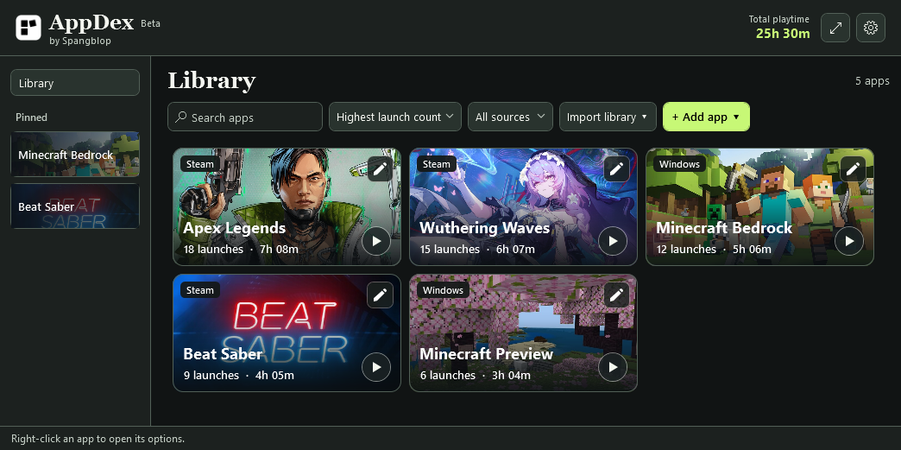
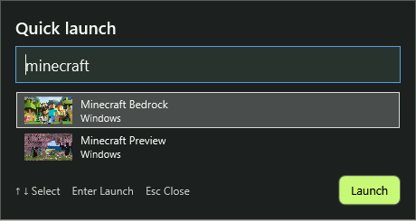
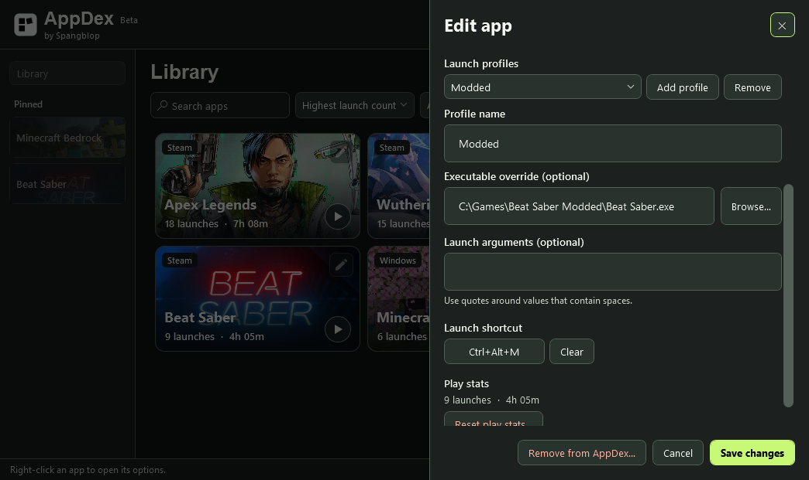
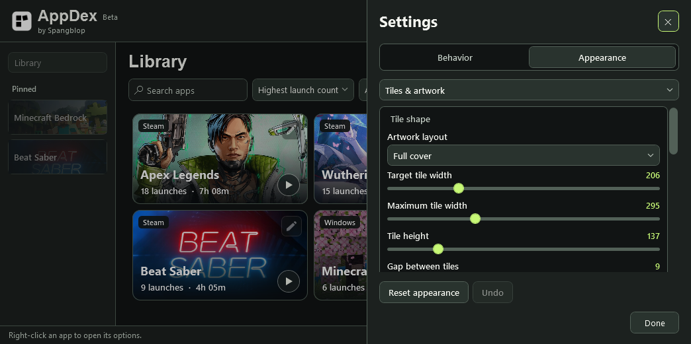

# AppDex

Windows app launcher, open source personal project that's just meant to be a quick way to launch apps from different app stores and all over your computer. Track's activity per game, imports installed Steam and Epic Games titles, and supports custom artwork, launch arguments, and appearance presets.

## Run

Download the Windows ZIP from [Releases](../../releases), extract it, and open `AppDex.exe`.

## Screenshots

### Library




### Quick Launch with Alt + x (Changeable)



### Launch profiles

Keep a modded setup on the same game tile, with its own executable and shortcut.



### Appearance



## Build from source

Use Visual Studio Build Tools with MSBuild and the .NET Framework 4.8 targeting pack. From a Developer PowerShell prompt, run:

```powershell
msbuild .\AppDex.csproj /p:Configuration=Release
```

The executable is written to `bin\Release\AppDex.exe`.

